# 姬路城 · 数据总表（可直接改）

> 图片用相对路径引用，在 VSCode / Typora 里打开即可预览。
> 改完把这份 md 发我，我按表更新 `js/data.js`。

## 一、地点：8 个骰位 + 3 个领地骰位

| # | 区域 | 名称      | X%   | Y%   | 骰点 | 备注      |
| - | -- | ------- | ---- | ---- | -- | ------- |
| 1 | 城堡 | 城堡·地头层左 | 36.6 | 74.3 | 3  | 印刷骰位方块  |
| 2 | 城堡 | 城堡·地头层中 | 58.5 | 74.2 | 3  | 印刷骰位方块  |
| 3 | 城堡 | 城堡·地头层右 | 80.6 | 73.9 | 3  | 印刷骰位方块  |
| 4 | 城堡 | 城堡·使节层左 | 40.8 | 53.7 | 4  | 印刷骰位方块  |
| 5 | 城堡 | 城堡·使节层右 | 62.8 | 53.7 | 4  | 印刷骰位方块  |
| 6 | 墙外 | 墙外1     | 83.4 | 93.4 | 5  | 放骰后二选一  |
| 7 | 墙外 | 墙外2     | 92   | 93.4 | 5  | 放骰后二选一  |
| 8 | 水井 | 水井      | 27.7 | 92.6 | 1  | 恒 1，不覆盖 |

| #  | 名称      | X%   | Y%   | 骰点 | 备注     |
| -- | ------- | ---- | ---- | -- | ------ |
| D1 | 领地·家臣队列 | 37.6 | 23   | 6  | 每条 1 颗 |
| D2 | 领地·园丁队列 | 37.6 | 41.5 | 6  | 每条 1 颗 |
| D3 | 领地·武士队列 | 37.6 | 56.9 | 6  | 每条 1 颗 |

## 二、卡牌

### 房间卡（10 张）

| 图                                        | 编号     | 名称   | 效果1    | 效果2   | 效果3   |
| ---------------------------------------- | ------ | ---- | ------ | ----- | ----- |
| 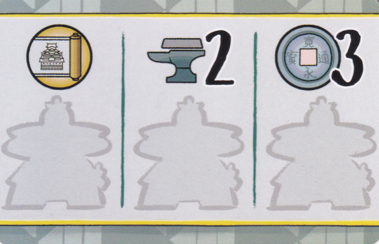 | `rc1`  | rc1  | 任意浅色效果 | +2铁   | +2钱   |
| 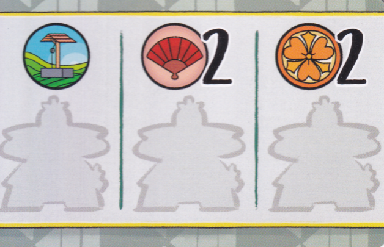 | `rc2`  | 五谷之间 | 水井效果   | +2红扇  | +2家纹  |
| 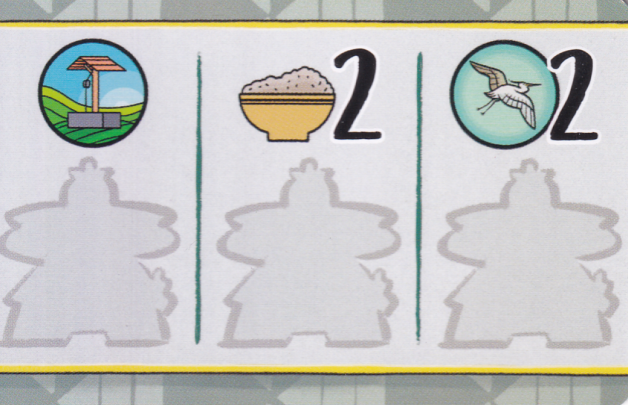 | `rc3`  | 渡桥之间 | 水井效果   | +2食物  | +2影响力 |
| 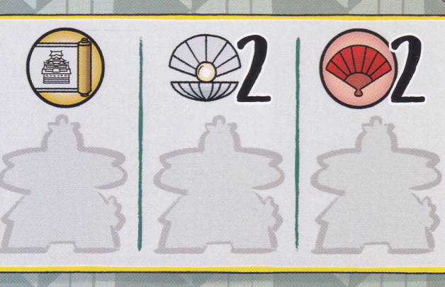 | `rc4`  | 稻田之间 | 任意浅色效果 | +2珍珠  | +2红扇  |
| 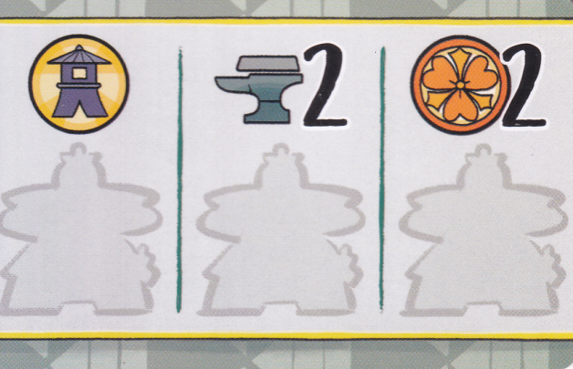 | `rc5`  | 天守之间 | 灯笼效果   | +2铁   | +2家纹  |
| 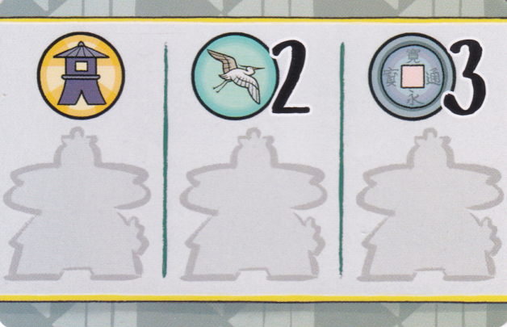 | `rc6`  | 青苗之间 | 灯笼效果   | +2影响力 | +3钱   |
| 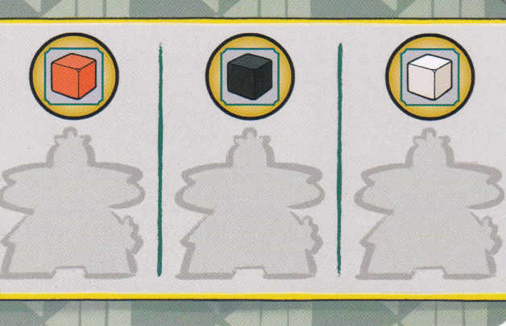 | `rc7`  | 旗印之间 | 红骰子    | 黑骰子   | 白骰子   |
| 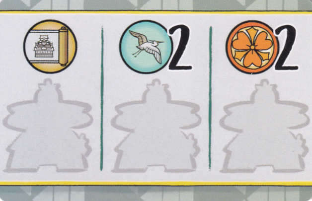 | `rc8`  | 早苗之间 | 任意浅色效果 | +2影响力 | +2家纹  |
| 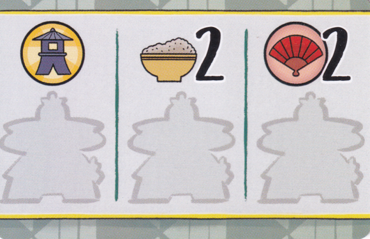 | `rc9`  | 庭师之间 | 灯笼效果   | +2食物  | +2红扇  |
| 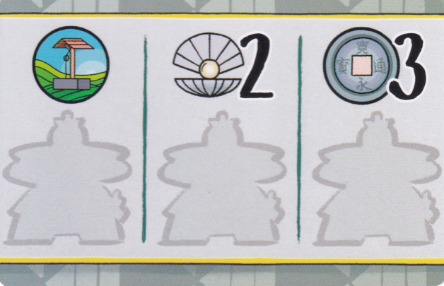 | `rc10` | 稻荷之间 | 水井效果   | +2珍珠  | +3钱   |

### 庭院卡（12 张）

| 图                                              | 编号    | 名称    | 支付   | 效果            | 终局    |
| ---------------------------------------------- | ----- | ----- | ---- | ------------- | ----- |
| 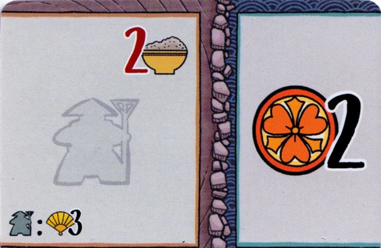 | `g1`  | 庭院a01 | -2食物 | +2家纹          | +3金扇子 |
| 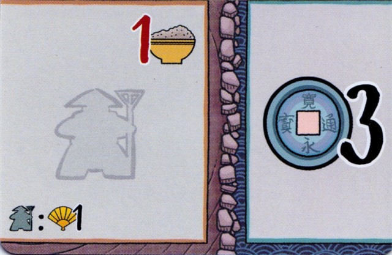 | `g2`  | 庭院a02 | -1食物 | +3钱           | +1金扇子 |
| 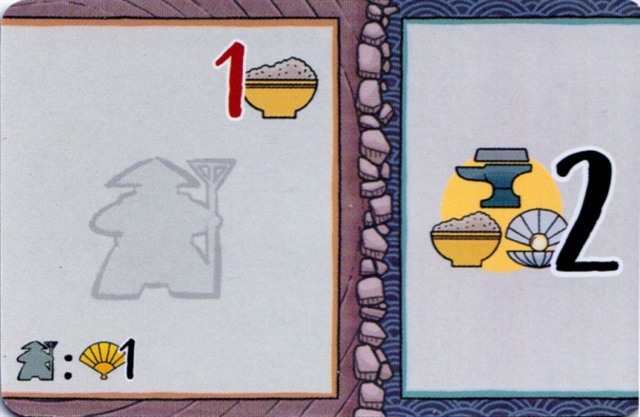 | `g3`  | 庭院a03 | -1食物 | +2任意基础资源      | +1金扇子 |
| 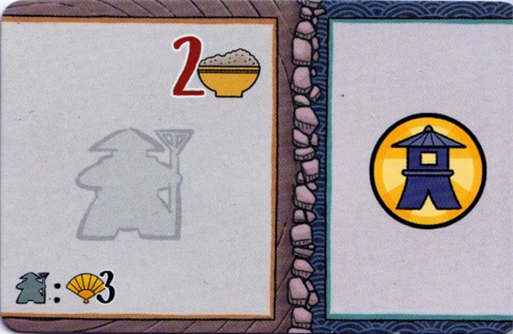 | `g4`  | 庭院a04 | -2食物 | 灯笼效果          | +3金扇子 |
| 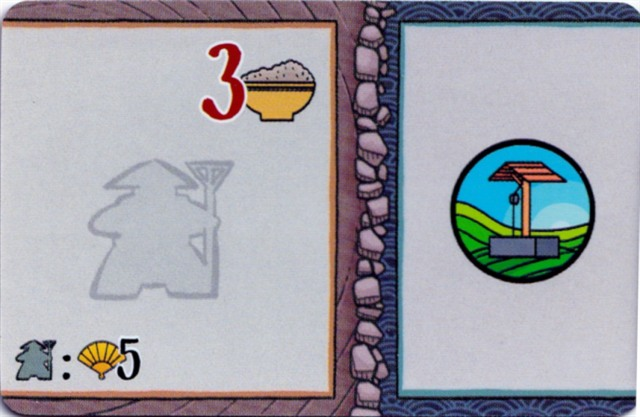 | `g5`  | 庭院a05 | -3食物 | 水井效果          | +5金扇子 |
| 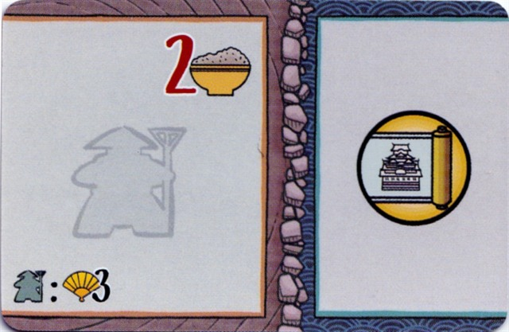 | `g6`  | 庭院a06 | -2食物 | 任意浅色奖励        | +3金扇子 |
| 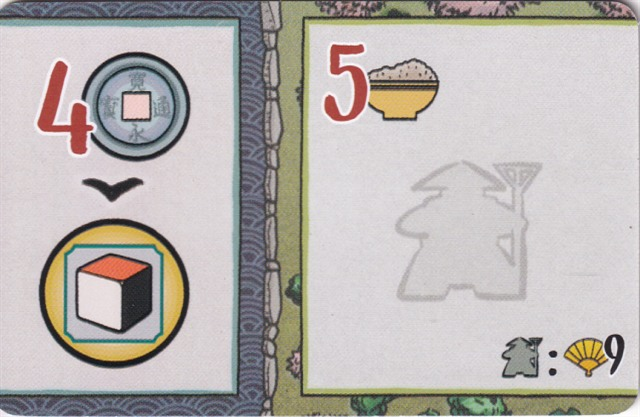 | `g7`  | 庭院b01 | -5食物 | -4钱，可以选任意骰子奖励 | +9金扇子 |
| 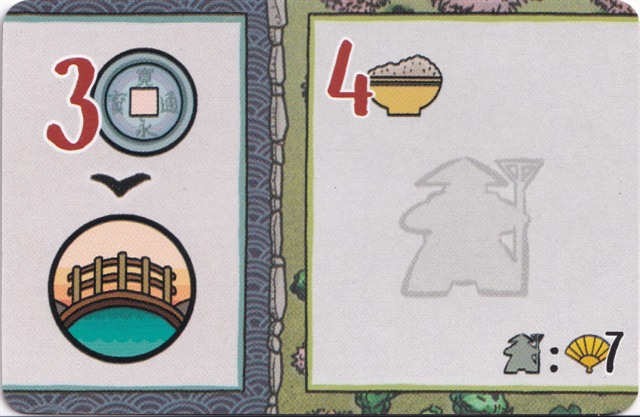 | `g8`  | 庭院b02 | -4食物 | -3钱，园丁奖励      | +7金扇子 |
| 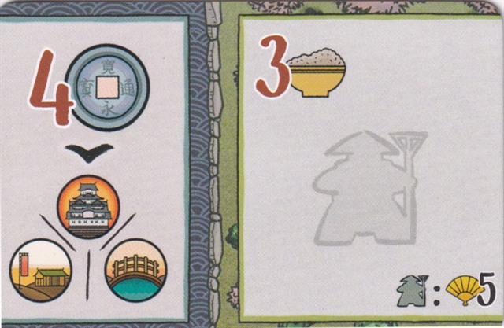 | `g9`  | 庭院b03 | -3食物 | -4钱，任意人物奖励    | +5金扇子 |
| 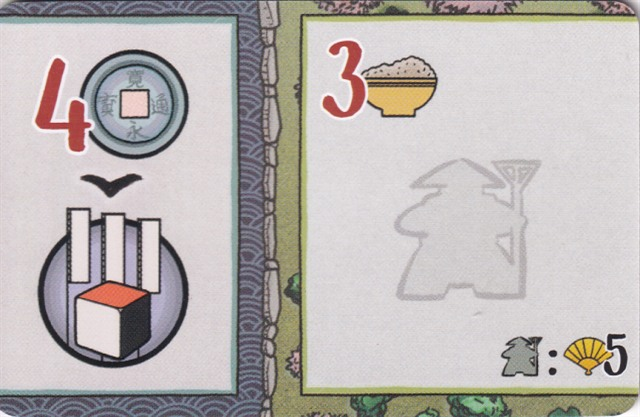 | `g10` | 庭院b04 | -3食物 | -4钱，玩家面板奖励    | +5金扇子 |
| 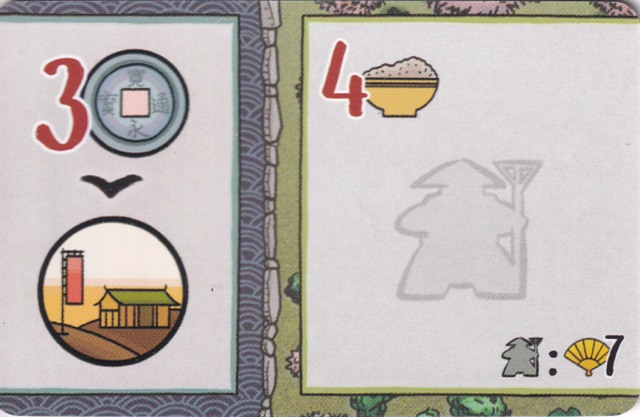 | `g11` | 庭院b05 | -4食物 | -3钱，武士奖励      | +7金扇子 |
| 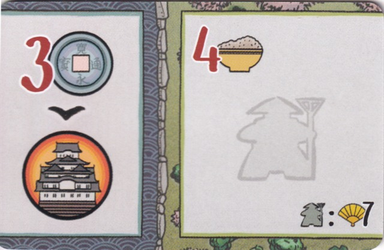 | `g12` | 庭院b06 | -4食物 | -3钱，家臣奖励      | +7金扇子 |

### 城郊A（15 张）

| 图                                                    | 编号     | 名称    | 颜色。效果1           | 颜色。效果2           | 颜色。效果3           | 卡背  | 备注     |
| ---------------------------------------------------- | ------ | ----- | ---------------- | ---------------- | ---------------- | :-- | :----- |
| 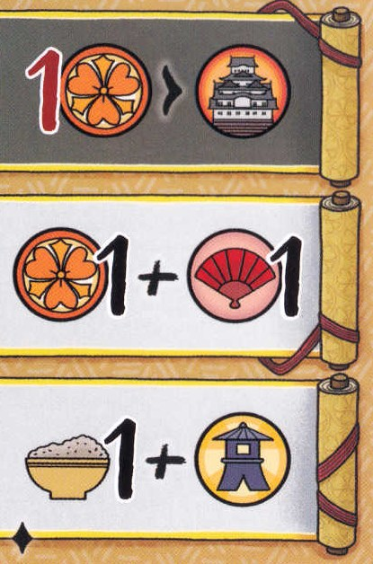 | `oa01` | 城郊a01 | **深色。-1家纹，家臣效果** | 浅色。+1家纹+1红扇      | 浅色。+1食物+灯笼奖励     | +1钱 | 2人局不用  |
| 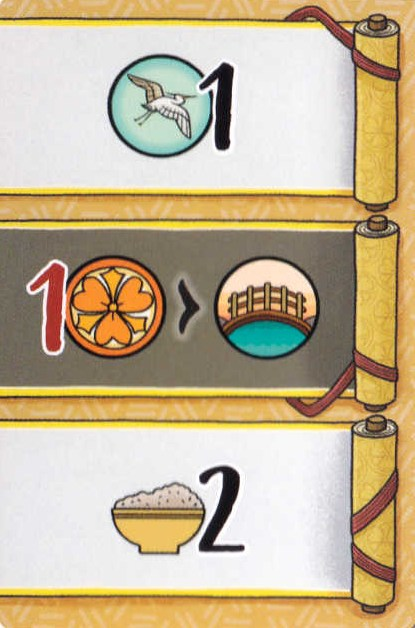 | `oa02` | 城郊a02 | 浅色。+1影响力         | **深色。-1家纹，园丁效果** | 浅色。+2食物          | +1钱 |   |
| 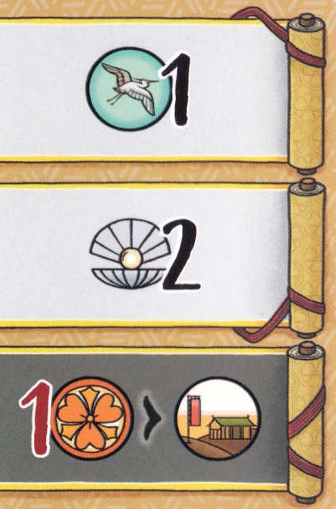 | `oa03` | 城郊a03 | 浅色。+1影响力         | 浅色。+2珍珠          | **深色。-1家纹，武士效果** | +1钱 |   |
| 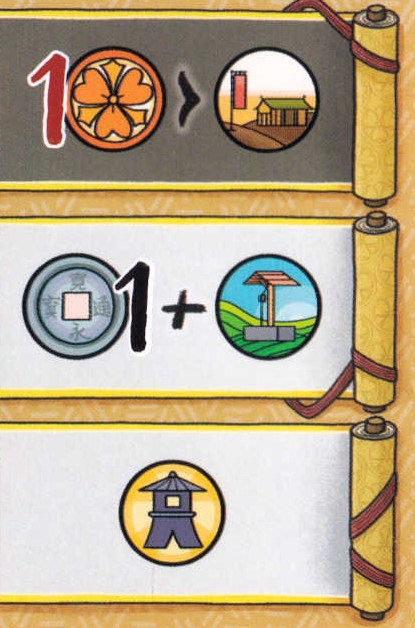 | `oa04` | 城郊a04 | **深色。-1家纹，武士效果** | 浅色。+1钱+水井奖励      | 浅色。+灯笼奖励         | +1钱 |   |
| 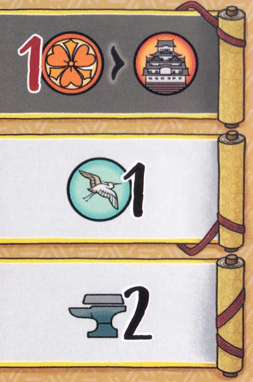 | `oa05` | 城郊a05 | **深色。-1家纹，家臣效果** | 浅色。+1影响力         | 浅色。+2铁           | +1钱 |   |
| 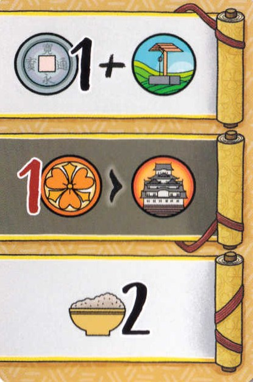 | `oa06` | 城郊a06 | 浅色。+1钱+水井奖励      | **深色。-1家纹，家臣效果** | 浅色。+2食物          | +1钱 |   |
| 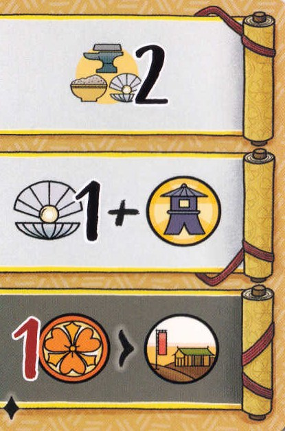 | `oa07` | 城郊a07 | 浅色。+2任意基础奖励      | 浅色。+1珍珠+灯笼奖励     | **深色。-1家纹，武士效果** | +1钱 | 2人局不用  |
| 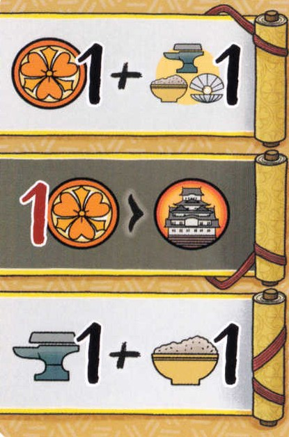 | `oa08` | 城郊a08 | 浅色。+1家纹+任意基础资源   | **深色。-1家纹，家臣效果** | 浅色。+1铁+1食物       | +1钱 |   |
| 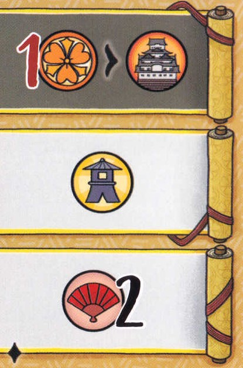 | `oa09` | 城郊a09 | **深色。-1家纹，家臣效果** | 浅色。+灯笼奖励         | 浅色。+2红扇          | +1钱 | 2人局不用  |
| 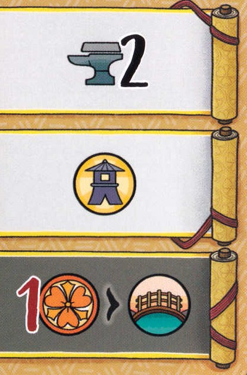 | `oa10` | 城郊a10 | 浅色。+2铁           | 浅色。+灯笼奖励         | **深色。-1家纹，园丁效果** | +1钱 |   |
| 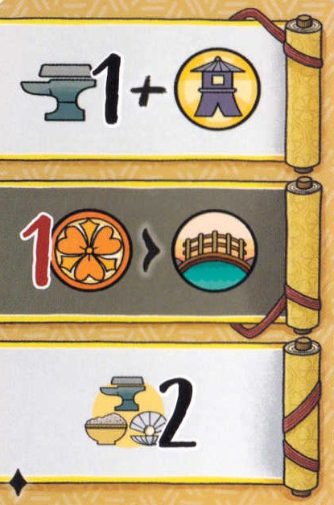 | `oa11` | 城郊a11 | 浅色。+1铁+灯笼奖励      | **深色。-1家纹，园丁效果** | 浅色。+2任意基础资源      | +1钱 | 2人局不用  |
| 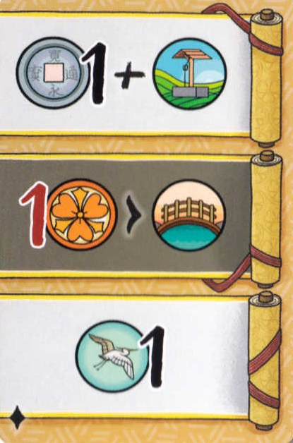 | `oa12` | 城郊a12 | 浅色。+1钱+水井奖励      | **深色。-1家纹，园丁效果** | 浅色。+1影响力         | +1钱 | 2人局不用  |
| 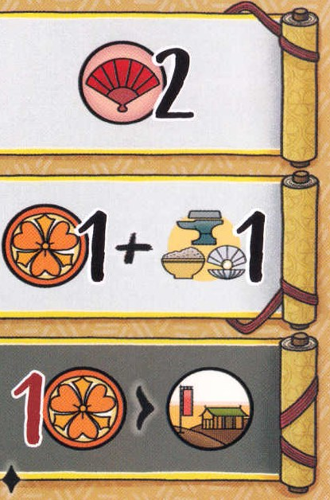 | `oa13` | 城郊a13 | 浅色。+2红扇          | 浅色。+1家纹+1任意基础资源  | **深色。-1家纹，武士效果** | +1钱 | 2人局不用  |
| 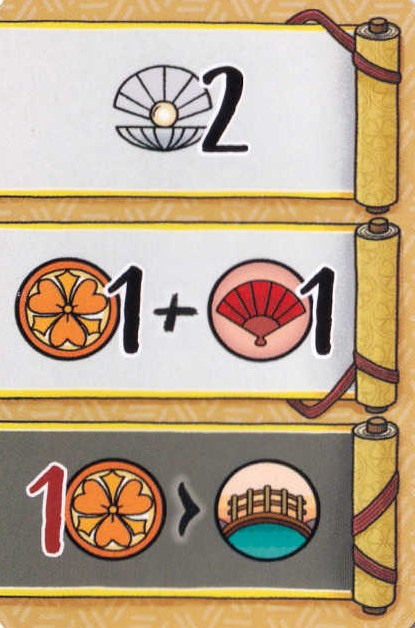 | `oa14` | 城郊a14 | 浅色。+2珍珠          | 浅色。+1家纹+1红扇      | **深色。-1家纹，园丁效果** | +1钱 |   |
| 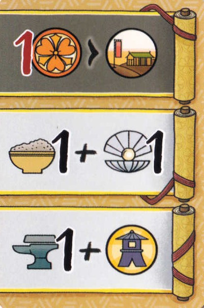 | `oa15` | 城郊a15 | **深色。-1家纹，武士效果** | 浅色。+1食物+1珍珠      | 浅色。+1铁+1灯笼奖励     | +1钱 |   |

### 城郊B（12 张）

| 图                                                    | 编号     | 名称    | 颜色。效果1        | 颜色。效果2        | 颜色。效果3       | 卡背   | 备注     |
| ---------------------------------------------------- | ------ | ----- | ------------- | ------------- | ------------ | :--- | :----- |
| 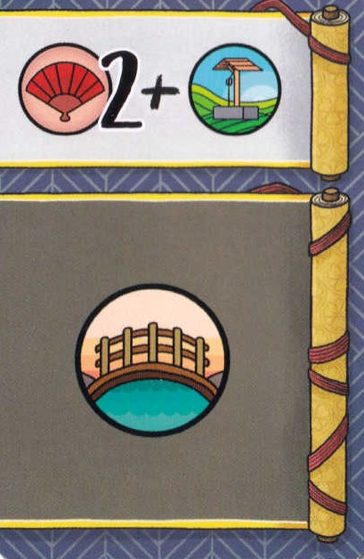 | `ob01` | 城郊b01 | 浅色。+2红扇+水井效果  | 深色。园丁效果       | 深色。园丁效果      | +1红扇 |   |
| 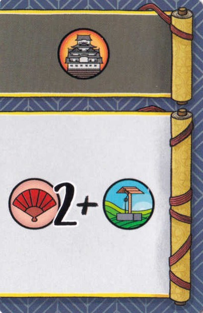 | `ob02` | 城郊b02 | 深色。家臣效果       | 浅色。+2红扇+水井效果  | 浅色。+2红扇+水井效果 | +1红扇 |   |
| 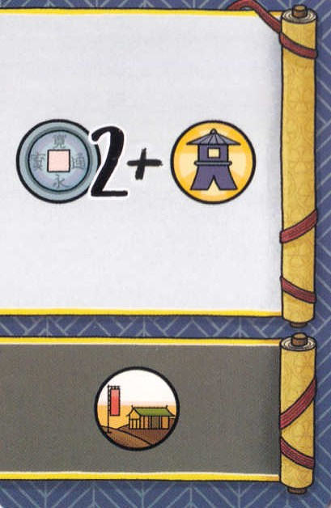 | `ob03` | 城郊b03 | 浅色。+2钱+灯笼效果   | 浅色。+2钱+灯笼效果   | 深色。武士效果      | +1红扇 |   |
| 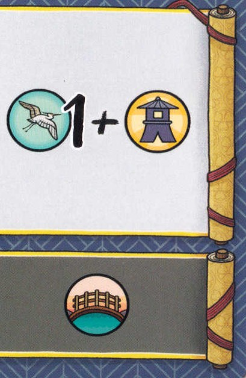 | `ob04` | 城郊b04 | 浅色。+1影响力+灯笼效果 | 浅色。+1影响力+灯笼效果 | 深色。园丁效果      | +1红扇 |   |
| 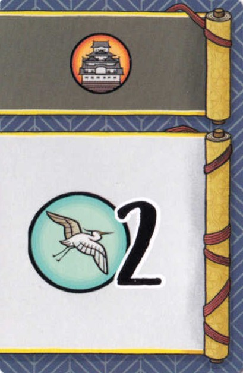 | `ob05` | 城郊b05 | 深色。家臣效果       | 浅色。+2影响力      | 浅色。+2影响力     | +1红扇 |   |
| 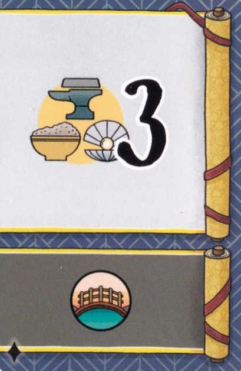 | `ob06` | 城郊b06 | 浅色。+3任意基础资源   | 浅色。+3任意基础资源   | 深色。园丁效果      | +1红扇 | 2人局不用  |
| 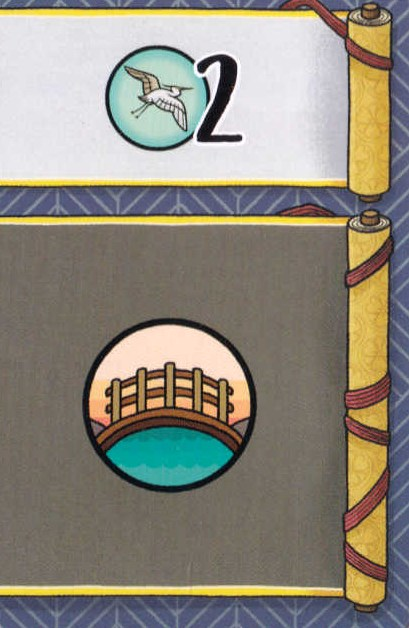 | `ob07` | 城郊b07 | 浅色。+2影响力      | 深色。园丁效果       | 深色。园丁效果      | +1红扇 |   |
| 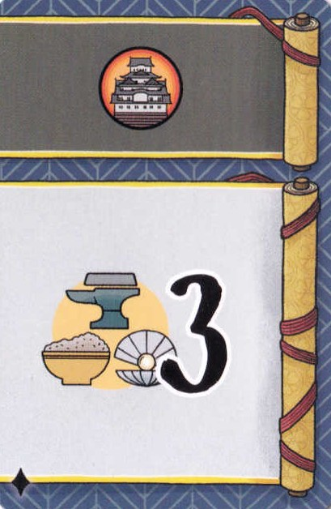 | `ob08` | 城郊b08 | 深色。家臣效果       | 浅色。+3任意基础资源   | 浅色。+3任意基础资源  | +1红扇 | 2人局不用  |
| 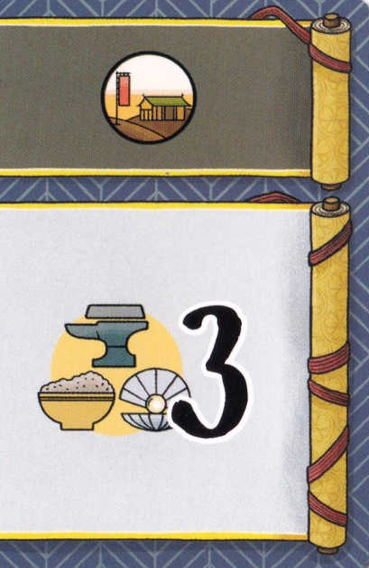 | `ob09` | 城郊b09 | 深色。武士效果       | 浅色。+3任意基础资源   | 浅色。+3任意基础资源  | +1红扇 |   |
| 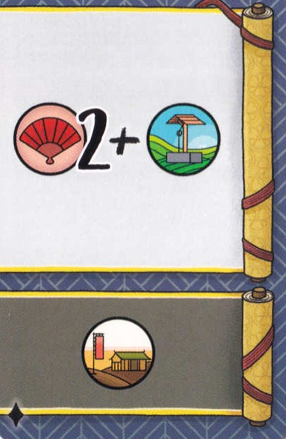 | `ob10` | 城郊b10 | 浅色。+2红扇+水井效果  | 浅色。+2红扇+水井效果  | 深色。武士效果      | +1红扇 | 2人局不用  |
| 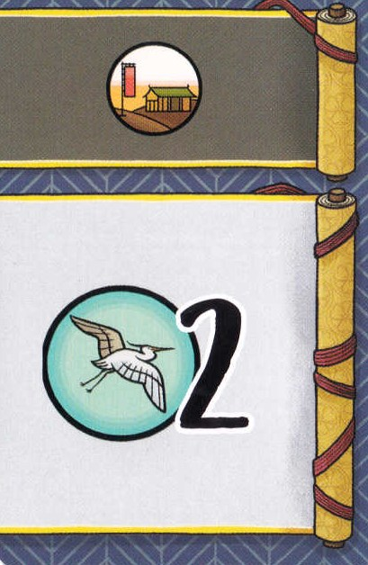 | `ob11` | 城郊b11 | 深色。武士效果       | 浅色。+2影响力      | 浅色。+2影响力     | +1红扇 |   |
| 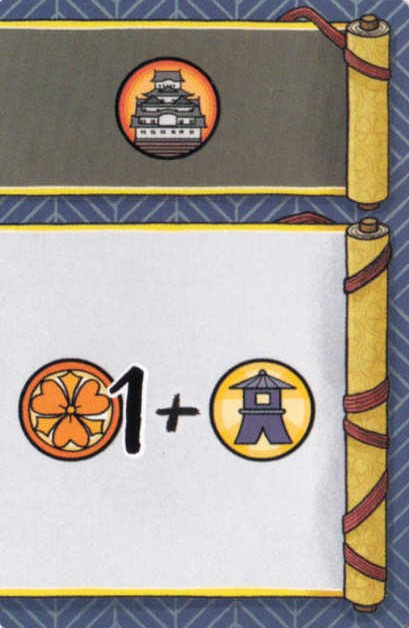 | `ob12` | 城郊b12 | 深色。家臣效果       | 浅色。+1家纹+灯笼效果  | 浅色。+1家纹+灯笼效果 | +1红扇 |   |

### 起始资源卡（9 张）

| 图                                                      | 编号    | 名称   | 卡背   | 额外     | 效果3    |
| ------------------------------------------------------ | ----- | ---- | ---- | ------ | ------ |
| 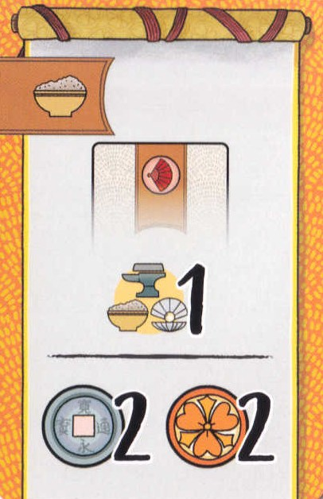   | `sf1` | 食旗·一 | +1食物 | +1红扇   |   |
|    | `sf2` | 食旗·二 | +1食物 |   |   |
|    | `sf3` | 食旗·三 | +1食物 |   |   |
|    | `si1` | 铁旗·一 | +1铁  |   |   |
|    | `si2` | 铁旗·二 | +1铁  | +1家纹   |   |
|    | `si3` | 铁旗·三 | +1铁  |   |   |
|  | `sp1` | 珠旗·一 | +1珍珠 |   |   |
|  | `sp2` | 珠旗·二 | +1珍珠 |   |   |
|  | `sp3` | 珠旗·三 | +1珍珠 |   |   |

> **「额外」列 = 法令牌。** 卡面中间那个小卷轴：抽到这张卡时另取 1 张对应法令卡放进灯笼奖励区。
> 目前只有 `sf1`（红扇法令）、`si2`（家纹法令）、`sp1`（钱币法令）三张带卷轴。
> 法令卡本身的效果在 `js/data.js` 的 `DECREE_CARDS` 里改（红扇/家纹/钱币 各 +1）。
> 注意：法令牌的效果**不要**再写进这张卡的「卡背」列，否则会重复结算。

### 起始行动卡（3 张）

| 图                                                     | 编号            | 名称  | 效果1  | 卡背    | 效果3    |
| ----------------------------------------------------- | ------------- | --- | ---- | ----- | ------ |
|   | `act-castle`  | 家臣令 | 家臣奖励 | +1影响力 |   |
|   | `act-bridge`  | 园丁令 | 园丁奖励 | +1影响力 |   |
|  | `act-village` | 武士令 | 武士奖励 | +1影响力 |   |

> **三张起始行动卡的「卡背」统一是 +1 影响力**（数据里写在 `backFx` 字段）。
>
> **进灯笼区的时机**：起始行动卡开局放在个人版图的**行动区**（正面朝上），**不进**灯笼区。
> 只有当它被城郊卡替换时才翻面进灯笼区 —— 例：拿 `oa08` 替换 `act-castle`，
> `oa08` 从主板图进入行动区，`act-castle` 从行动区进入灯笼区并提供 +1 影响力。
> 实现见 `engine.js` 的 `gainCard()`（个人版图只有一个行动卡槽 `p.domain.actionCard`）。
>
> 灯笼区里的卡**一律按卡背结算**：`lanternCardEffects()` 优先读 `backFx`，
> 没有才回落到 `fx` / `back` / `fx3`。所以起始行动卡的正面效果（家臣/园丁/武士行动）
> 不会在灯笼区被重复结算。

## 三、标记（assets/tiles 256px）

| 图                          | id     | 名称    | 用在哪    |
| -------------------------- | ------ | ----- | ------ |
|  | `mk_a` | 红方块   |   |
|  | `mk_b` | 黑方块   |   |
|  | `mk_c` | 白方块   |   |
|   | `mk1`  | 任意一基础 |   |
|   | `mk2`  | 铁     |   |
|   | `mk3`  | 珍珠    |   |
|   | `mk4`  | 食物    |   |
|   | `mk5`  | 钱     |   |
|   | `mk6`  | 红扇    |   |
|   | `mk7`  | 影响力   |   |
|   | `mk8`  | 家纹    |   |

## 四、训练场板块（assets/tiles 520×399）

| 图                            | id       | 名称       | 效果       |
| ---------------------------- | -------- | -------- | -------- |
|  | `bk_H_1` | bk\_H\_1 | 水井奖励     |
|  | `bk_H_2` | bk\_H\_2 | 任选一浅色奖励  |
|  | `bk_H_3` | bk\_H\_3 | +5钱      |
|  | `bk_H_4` | bk\_H\_4 | +2家纹     |
|  | `bk_H_5` | bk\_H\_5 | +2影响力    |
|  | `bk_H_6` | bk\_H\_6 | +2红扇     |
|  | `bk_H_7` | bk\_H\_7 | +3食物     |
|  | `bk_H_8` | bk\_H\_8 | 任选2资源    |
|  | `bk_H_9` | bk\_H\_9 | +3珍珠     |
|  | `bk_L_1` | bk\_L\_1 | 家臣效果     |
|  | `bk_L_2` | bk\_L\_2 | 任选人物效果   |
|  | `bk_L_3` | bk\_L\_3 | 园丁效果     |
|  | `bk_L_4` | bk\_L\_4 | 红骰子      |
|  | `bk_L_5` | bk\_L\_5 | 玩家面板任意效果 |
|  | `bk_L_6` | bk\_L\_6 | 武士效果     |
|  | `bk_L_7` | bk\_L\_7 | 白骰子      |
|  | `bk_L_8` | bk\_L\_8 | 黑骰子      |
|  | `bk_L_9` | bk\_L\_9 | 任意骰子     |

***

## 五、界面展示约定（2026-10 改版 · 第二轮）

> 这一节不描述卡牌数据，只说明「效果在界面上怎么显示、在哪儿改」。

1. **版图黑标签只写地点名**
   - 放骰子时版图上那圈黄虚线 + 黑底小字（`engine.js → placeTargets()` 的 `label`）：
     写「千叠室 / 墙外1 / 水井 / 领地·食物」这类**地点名**，不写效果。
   - 选完地点之后，`resolvePlace()` 的 `finish()` 会把这一手**要执行的效果**写进日志
     （「结算效果：+1铁，家臣行动」），同时给人类玩家弹一条底部提示条（`#toast`）。
   - 弹窗里的选项（武士/园丁/城堡/城郊/训练场/晋升）仍按「条件 + 效果」写，
     因为它们本身就是「选哪个效果」，写地点名反而看不出收益。
2. **支付先行**
   - 一条效果链里所有支付（`{op:'gain', n<0}`）都排到最前面：展示时写在最前，
     结算时也最先扣。`orderEffects()` 统一排序，`describeEffects()` 与
     `applyEffects()` 共用这一份顺序。
   - 开链前整体预检：任何一项付不起 → **整条效果不结算**，日志会打「付不起 X，本条效果不结算」。
   - 显示成「支付3铁」，不再显示「-3铁」；多项之间用「，」分隔。
3. **影响力跨季：玩家自己决定付不付家纹**
   - 影响力前进要跨过 6/11/15 三个检查点时，不再自动扣纹，而是弹二选一：
     「支付 N 家纹，影响力前进至 X 格」／「不支付家纹，影响力停在第 N−1 格」。
   - 家纹不够时不给选项，直接停在本季最后一格。实现见 `engine.js → stepTime / resolveTimeMove`。
4. **个人面板（领地）的效果由「行动卡上的人」决定**
   - 三行是资源带：coral＝食物、black＝铁、white＝珍珠（`QUEUE_STRIPS[].laneName`）。
   - 放骰 = 该行下一格奖励 + **行动卡上那个人**的行动。
     起始行动卡（家臣令/庭师令/武家令，`isStartAction: true`）三行通用；
     城郊卡当行动卡时，按骰色取卡面第 1/2/3 列。
   - 实现见 `engine.js → domainCardEffects()`。
5. **左端骰：先结算灯笼，再放骰**
   - 取桥左端骰时立刻结算个人领地灯笼区的全部图标（可能带选择），结算完再放骰。
   - 实现见 `engine.js → resolveTake()`（`startLantern(g, p, 'take')`）。
6. **灯笼奖励区（个人面板下方浅色空白区）**
   - 卡背**完整显示**并**逆时针转 90°** 横躺，后一张压在前一张上面。
   - 想调「盖住多少」只改 `css/style.css` 的 `--lan-step`（当前 3.6cqw，越小盖得越多）。
   - 一行最多 12 张，超出用「+N」收尾；位置锚点仍是 `BOARD_LAYOUT.domain.base.lantern`。
7. **右侧「玩家数据」四排**
   - ① 玩家名称 / 金扇 / 红扇 / 总分（实时算，走 `scoreBreakdown().total`）
   - ② 钱 / 家纹 / 影响力（不显示分数）/ 铁·食·珠
   - ③ 家臣（门/地/使/大）/ 武士 / 园丁
   - ④ 灯笼区（张数 + 汇总图标）
   - 想微调行内间距：`css/style.css` 的 `.pbar .prow { gap: 1px 9px }`（第二个值＝横向间距）。
8. **撤销**
   - 状态栏和**选择弹窗右上角**都有撤销按钮；`legalCommands()` 在 pending 状态下也会给出 `undo`。

